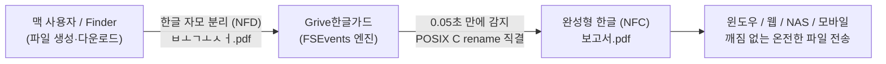
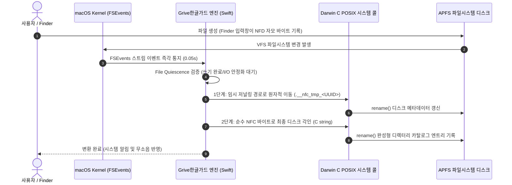

# Grive한글가드 (GriveHangulGuard) 🍏🇰🇷

> **macOS 한글 자모 분리(`ㅂㅗㄱㅗㅅㅓ`) 원천 방지 및 완성형(NFC) 자동 수복 올인원 솔루션**  
> Swift 6.4 네이티브 초경량 데몬(FSEvents) + 네이티브 관리 앱(`GriveHangulGuard.app`) + Finder 우클릭 빠른 동작 + CLI 도구

---

## 🎯 Grive한글가드의 역할 (What We Do)

맥(macOS)을 사용하면서 윈도우나 리눅스 사용자, 웹 드라이브, 사내 NAS로 파일을 보낼 때 **`ㅂㅗㄱㅗㅅㅓ.docx`**처럼 글자가 낱글자로 흩어지는 현상을 한 번쯤 겪어보셨을 것입니다.

**Grive한글가드는 사용자가 일일이 신경 쓰거나 수동으로 변환할 필요 없이, 시스템 백그라운드에서 한글 파일명을 온전한 완성형(NFC)으로 상시 유지해 주는 시스템 수준의 수호자입니다.**



### 3대 핵심 역할
1. **실시간 시스템 수호자 (Real-time Watcher)**  
   바탕화면, 다운로드, 문서 등 주요 작업 폴더에 한글 파일이 생성되거나 이름이 바뀌는 순간, **0.05초 만에 완성형(NFC)으로 즉각 자동 결합**합니다.
2. **기존 파일 전수 수복기 (Deep Scan & Recovery)**  
   실시간 감시 전 이미 분리되어 디스크나 외장하드(SSD/USB)에 누적되어 있던 수만 개의 파일과 깊은 폴더 트리를 **클릭 한 번으로 안전하게 전수 탐색·수복**합니다.
3. **이종 플랫폼 클린 브릿지 (Windows-Clean Compressor)**  
   맥 특유의 숨김 파일(`.DS_Store`, `__MACOSX`)을 완전히 배제하고, ZIP 헤더에 UTF-8 플래그를 각인하여 **윈도우 탐색기에서 한글이 100% 온전하게 풀리는 클린 ZIP 압축**을 제공합니다.

---

## 🔬 어떻게 가능한가요? (How It Works: 심층 엔지니어링 원리)

macOS의 한글 자모 분리는 단순한 문자열 인코딩 문제가 아니라, **수십 년간 누적된 OS 파일시스템과 상위 프레임워크의 구조적 레거시** 때문입니다. Grive한글가드는 이를 5가지 핵심 엔지니어링 기법으로 해결했습니다.



### 1. Cocoa URL 강제 NFD 버그 우회 ➔ POSIX C `rename()` 시스템 콜 직결
* **원인**: Apple의 고수준 Cocoa Foundation 프레임워크(`URL(fileURLWithPath:)`, `FileManager.moveItem`)는 내부적으로 경로 문자열을 디스크에 전달할 때 무조건 `decomposedStringWithCanonicalMapping`(NFD)으로 분해해 버리는 유서 깊은 버그/동작 특성을 가지고 있습니다. 즉, Swift/Objective-C의 표준 파일 API를 쓰면 아무리 완성형으로 바꾸려 해도 다시 자모가 분리됩니다.
* **해결**: Grive한글가드는 Apple의 고수준 Foundation 경로 생성자를 완전히 건너뛰고, **Darwin 커널의 POSIX C 표준 `rename(const char *old, const char *new)` 시스템 콜**을 직접 호출합니다. 이를 통해 상위 프레임워크의 변형 간섭 없이 **APFS 디스크 섹터에 100% 순수 UTF-8 완성형(NFC) 바이트 배열을 물리적으로 직접 기록**합니다.

### 2. APFS의 Normalization-Preserving 극복 ➔ 2단계 원자적 스왑(2-Step Swap) 및 Crash-Safe 저널링
* **원인**: 현대 macOS의 APFS(Apple File System)는 파일명의 대소문자나 유니코드 정규화 형식을 보존(Preserving)하지만 비교는 동등하게 처리(Insensitive)합니다. 즉, 같은 디렉터리에서 `ㅂㅗㄱㅗㅅㅓ`를 `보고서`로 바로 rename하려고 하면 APFS가 "이미 같은 파일이 존재한다"고 판단하여 변경을 무시합니다.
* **해결**: 
  1. 1단계: 임시 저널링 파일명(`.__nfc_tmp_<UUID>_<TargetName>`)으로 이동.
  2. 2단계: 온전한 완성형(NFC) 이름으로 최종 이동.
* **크래시 복구 저널링 (Crash Safety)**: 대량 변환 도중 배터리가 방전되거나 시스템이 강제 종료되어도, 엔진이 부팅되거나 다음 스캔 시 `.__nfc_tmp_*` 접두사와 원래 파일명 메타데이터를 감지하여 본래 이름으로 100% 자동 롤백/복구합니다.

### 3. 무소음 저전력 상주 ➔ FSEvents 커널 이벤트 직접 바인딩
* **원인**: 주기적으로 폴더를 뒤지는 폴링(Polling) 방식은 디스크 I/O를 끊임없이 유발하고 CPU와 배터리를 급격히 소모시킵니다.
* **해결**: macOS 커널의 파일시스템 이벤트 알림 서브시스템인 **FSEvents C API**를 네이티브 바인딩했습니다. 파일 변경이 일어날 때만 커널이 프로세스를 깨우므로 **CPU 점유율 0.0%, 메모리 약 9~10MB**로 동작하며, 배터리를 일절 낭비하지 않습니다.
* **I/O 안정화 검증 (File Quiescence)**: 대용량 파일 복사나 브라우저 다운로드 도중에는 파일 쓰기 스트림이 완전히 닫힐 때까지 대기한 뒤 정규화를 수행하여 파일 손상을 방지합니다.

### 4. 윈도우 ZIP 한글 깨짐 원천 차단 ➔ 바이너리 헤더 `0x0800` 인메모리 패치
* **원인**: macOS 기본 `ditto`나 `zip`은 압축을 생성할 때 ZIP 규격의 Local File Header 및 Central Directory Header에 존재하는 **UTF-8 플래그(Language Encoding Flag, Bit 11 = 0x0800)**를 켜지 않습니다. 따라서 윈도우 탐색기는 파일명을 레거시 ANSI(CP949)로 오인하여 외계어로 깨져서 풀리게 됩니다.
* **해결**: 
  1. `ditto --norsrc` 시스템 엔진을 활용하여 `.DS_Store`와 리소스 포크(`__MACOSX`) 생성을 원천 차단.
  2. 생성된 ZIP 바이너리를 바이트 단위로 읽어 모든 파일 엔트리의 **일반 목적 비트 플래그에 `0x0800` 비트를 인메모리 강제 각인**.
  3. 결과적으로 윈도우 탐색기, 알집, 반디집, 7-Zip 등 모든 환경에서 압축이 완벽한 한글로 풀립니다.

### 5. 깊은 디렉터리 순회 무결성 ➔ 역방향 바텀업(Bottom-up) 탐색
* **원인**: 수만 개의 기존 파일을 일괄 스캔할 때 상위 폴더 이름(`첫번째_폴더`)을 먼저 바꾸면, 그 아래에 있던 모든 자식 파일들의 절대 경로(`첫번째_폴더/하위_파일.txt`)가 끊어져 에러가 발생합니다.
* **해결**: 파일 트리를 수집한 후 경로 깊이(Depth) 기준으로 내림차순 정렬하여, **가장 깊숙한 리프 노드(하위 파일)부터 먼저 완성형으로 수복하고 마지막에 최상위 폴더를 갱신**합니다. 이로써 단 한 건의 경로 유실도 발생하지 않습니다.

---

## 🖥️ 네이티브 GUI 앱 지원 (GriveHangulGuard.app)

터미널이나 명령어가 익숙하지 않은 사용자를 위해 **독립형 macOS GUI 관리 앱 (`GriveHangulGuard.app`)**을 함께 제공합니다.

* **원클릭 설치 및 가동**: 버튼 클릭 한 번으로 모든 컴포넌트 설치 및 백그라운드 데몬 가동
* **기존 생성 파일 전수 수복 (Deep Scan)**: 기본 작업 폴더 및 외장하드 선택 일괄 수복
* **권한 점검 및 바로가기**: 로그인 항목, 전체 디스크 접근 권한(TCC), Finder 확장 권한을 앱에서 원클릭으로 열고 확인
* **실시간 상태 & 로그 뷰어**: 데몬 실행 상태(PID)와 실시간 파일 변환 로그를 한눈에 모니터링
* **자가 진단 테스트**: 버튼 클릭으로 실시간 NFD ➔ NFC 변환이 정상 작동하는지 즉시 검증

```bash
# 앱 실행 (또는 Finder에서 GriveHangulGuard.app 더블클릭)
open GriveHangulGuard.app
```

---

## ✨ 핵심 기능 요약

### 1. 100% 순수 macOS 네이티브 (Zero-Dependency)
* **Python 의존성 0%**: 개발자 도구(Xcode CLT)나 파이썬이 없는 순정 맥에서도 단 115KB짜리 **Swift 네이티브 단일 바이너리(`nfc_watcher`)** 하나로 모든 기능(데몬 + 우클릭 도구 + 터미널 CLI)이 동작합니다.
* **BusyBox 멀티콜 패턴**: 바이너리 심볼릭 링크 이름(`winzip`, `fix-korean-jamo`, `nfc-watcher`, `grive-scan`)에 따라 스스로 서브커맨드로 자동 라우팅됩니다.

### 2. 무소음 백그라운드 자동 정규화 (FSEvents 데몬)
* **무소음 무개입 (Zero-Touch)**: 파일 생성/변경 순간 0.05초 만에 완성형(NFC) 결합.
* **초경량 저전력**: RAM 약 9~10MB, CPU 0.0% 상주.
* **버퍼 오버플로우 자동 치유**: 대량 이동 시 FSEvents 버퍼가 넘쳐도 해당 디렉터리를 자동 재귀 스윕.

### 3. 기존 파일 전수 수복 (Deep Recursive Scan)
* **디스크/외장하드 전수 탐색**: 이미 저장되어 있던 대량의 NFD 자모 분리 파일이나 외장 드라이브를 일괄 탐색하여 온전한 NFC로 결합.
* **미리보기 모드 지원 (`--dry-run`)**: 실제 파일명을 변경하기 전 대상 파일 목록과 변환 예상 결과를 안전하게 미리 검토 가능.

### 4. 윈도우 호환 클린 ZIP 압축
* `.DS_Store`와 `__MACOSX` 찌꺼기 100% 배제.
* 자체 ZIP 바이너리 패처로 0x0800 플래그 각인.

---

## 🚀 다른 맥에 설치하는 방법 (초간단)

### 방법 A. 공식 공증 DMG 다운로드 (가장 추천 🍏)

GitHub Releases에서 Apple 공식 공증 및 Developer ID 서명이 완료된 설치 파일을 내려받아 즉시 사용합니다:

👉 **[공식 릴리스 페이지 바로가기 (v1.0.2)](https://github.com/haegyung/grive-hanguleguard.app/releases/tag/v1.0.2)**  
* **[GriveHangulGuard.dmg (드래그 앤 드롭 설치 디스크)](https://github.com/haegyung/grive-hanguleguard.app/releases/download/v1.0.2/GriveHangulGuard.dmg)**
* **[GriveHangulGuard-v1.0.2-notarized.zip (독립형 앱 압축)](https://github.com/haegyung/grive-hanguleguard.app/releases/download/v1.0.2/GriveHangulGuard-v1.0.2-notarized.zip)**

> 🛡️ **Gatekeeper 공인 완료**: Apple Notary Service 공증 및 Hardened Runtime이 적용되어, "확인되지 않은 개발자" 경고창 없이 더블 클릭으로 즉시 실행됩니다.

---

### 방법 B. 소스코드 저장소 클론 후 원클릭 설치
개발 환경이거나 터미널 스크립트로 직접 시스템에 상주시키려면:

```bash
git clone https://github.com/haegyung/grive-hanguleguard.app.git
cd grive-hanguleguard.app
./install.sh
```

또는 `make` 지원:
```bash
make install
```

> **설치 스크립트(`install.sh`)가 자동으로 처리하는 내용:**
> 1. Swift 컴파일러가 있으면 최신 최적화 바이너리 즉시 빌드 및 Ad-hoc 코드 서명
> 2. `~/.local/bin/finder-tools/`에 도구 배치 및 `~/.local/bin/`에 심볼릭 링크(`winzip`, `fix-korean-jamo`, `nfc-watcher`, `grive-scan`) 생성
> 3. Finder 우클릭 [빠른 동작] 메뉴 2종 자동 설치 및 서비스 캐시 갱신
> 4. `launchd` 백그라운드 데몬 현대식 등록 및 즉시 가동 (`com.grive.hangulguard`)
> 5. 실시간 자가 진단(Self-Test) 자동 수행

---

## ⚙️ 설정 커스터마이징

기본 감시 경로는 `바탕화면`, `다운로드`, `문서`입니다. 추가로 감시하고 싶은 폴더가 있다면 설정 파일에 추가할 수 있습니다:

* **설정 파일 위치**: `~/.config/finder-tools/watcher_config.json`
```json
{
  "watch_paths": [
    "/Users/username/Desktop",
    "/Users/username/Downloads",
    "/Users/username/Documents",
    "/Users/username/Projects"
  ]
}
```
* 변경 후 데몬 재시작:
```bash
launchctl bootout gui/$(id -u)/com.grive.hangulguard
launchctl bootstrap gui/$(id -u) ~/Library/LaunchAgents/com.grive.hangulguard.plist
```

---

## 📊 상태 및 로그 확인

백그라운드 데몬이 정상 작동 중인지 확인하거나 변환 내역을 보려면:

```bash
# 데몬 프로세스 상주 여부 확인
launchctl list | grep hangulguard

# 실시간 파일 변환 로그 스트리밍
tail -f ~/.local/state/finder-tools/nfc_watcher.log
```

---

## 🗑️ 완전 제거 (Uninstall)

설치된 모든 컴포넌트(데몬, 우클릭 메뉴, CLI 명령어, 바이너리)를 깔끔하게 지우고 싶다면:

```bash
cd macos-hangul-nfc-cleaner
./uninstall.sh
```
또는
```bash
make uninstall
```

---

## 📂 프로젝트 구조

```
macos-hangul-nfc-cleaner/
├── README.md                           # 프로젝트 문서
├── Makefile                            # make 빌드/설치 지원
├── install.sh                          # 원클릭 6단계 멱등 설치 스크립트
├── uninstall.sh                        # 완전 제거 스크립트
├── GriveHangulGuard.app                # 네이티브 GUI 관리 앱
├── app/
│   ├── build_app.sh                    # SwiftUI 앱 번들 컴파일러
│   └── src/main.swift                  # SwiftUI 관리 인터페이스
├── bin/
│   └── nfc_watcher                     # 컴파일된 Swift 네이티브 arm64 바이너리
├── src/
│   ├── nfc_watcher.swift               # Swift FSEvents 데몬 + Scan + Fix + Zip 올인원 엔진
│   ├── winzip.py                       # 윈도우 호환 클린 ZIP CLI (호환용)
│   └── fix_korean_jamo.py              # APFS 2단계 한글 복구 CLI (호환용)
├── services/
│   ├── 윈도우 호환 압축 (ZIP).workflow
│   └── 한글 자모 결합 (NFC 변환).workflow
└── launchd/
    └── com.grive.hangulguard.plist.template
```

## 🛡️ 라이선스

이 프로젝트는 **Creative Commons Attribution-NonCommercial 4.0 International (CC BY-NC 4.0)** 라이선스를 따릅니다.

* **비영리 목적**: 자유롭게 복제, 배포, 전시, 공연 및 2차적 저작물 작성이 가능합니다.
* **저작자 표시**: 원작자(`haegyung`) 및 프로젝트 출처를 명시해야 합니다.
* **상업적 이용 불가**: 영리 목적의 상업적 이용 및 재판매는 허용되지 않습니다. (상업적 이용 문의: 저작자 문의)
